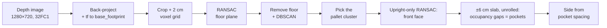
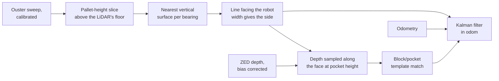
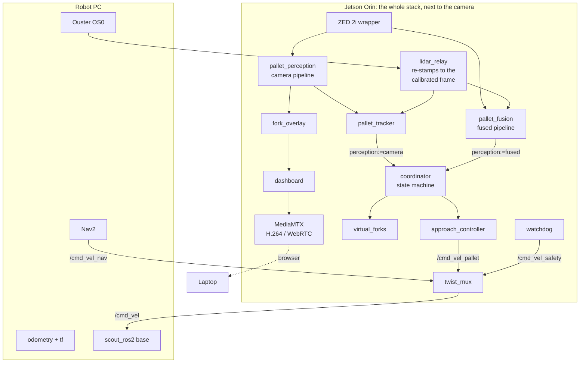
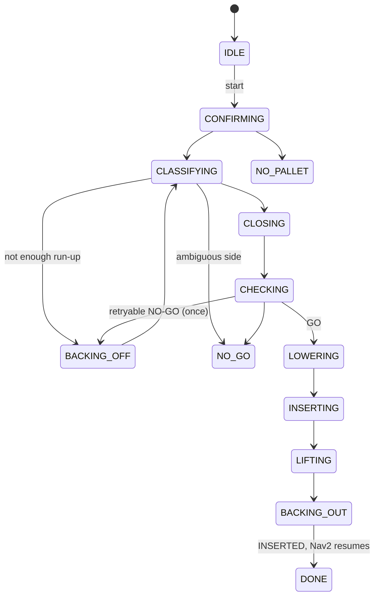

# Pallet Approach on a Real Robot

Camera-LiDAR pallet detection, fork-pocket alignment and a virtual pickup on an
AgileX SCOUT 2.0 with a ZED 2i stereo camera and an Ouster LiDAR, in ROS 2 Humble.

Nav2 brings the robot to within a few metres of a pallet. This stack is
designed to take over from there. It finds the pallet, measures its face and
fork pockets, and works out which face it is looking at. It then
drives onto the fork-pocket centre line and decides **GO** or **NO-GO** with a
stated reason. On GO it performs a **virtual pickup**: it lowers imaginary forks
to pocket height, drives them in, lifts, backs out, and hands control back to
Nav2.

> **Status.** There are two perception pipelines. The original one uses only the
> camera; it has been validated on depth recorded on the robot and completes
> pickups in Gazebo. The new **fused** one finds the face with the LiDAR and
> the pockets with the camera; it has been scored against tape-measured bags
> from the robot and has run alongside the camera pipeline in Gazebo. It has not
> yet driven a run to GO, in the simulator or on the robot. The camera-LiDAR
> calibration is measured and wired in. Nothing has run closed-loop on the
> robot yet.

There is no trained model. The pipeline is plane and line fitting, clustering,
template matching and a Kalman filter, so it needs no labelled data and every
decision it makes can be read off a log.

<!--
  Robot photo: save it as docs/images/robot.jpg and uncomment this line.
  <p align="center"></p>
-->

<p align="center">
  
  <br>
  <em>Every stage of the perception pipeline on a real recorded frame, short
  face 1.75 m ahead. Both pockets found (solid green: 217 × 82 and
  232 × 86 mm) where the measured 230 × 100 mm pockets should be (dashed).</em>
</p>

<p align="center">
  
  <br>
  <em>The pipeline running on a recorded bag from the robot, as the operator sees
  it: the virtual tines drawn from the robot's own geometry, the detected
  pockets (solid) on their expected outlines (dashed), and the same estimate
  from above. Short face at 1.76 m, spacing within 5 mm.</em>
</p>

## Contents

- [What it does](#what-it-does)
- [How it works](#how-it-works)
- [Architecture](#architecture)
- [Safety design](#safety-design)
- [Results so far](#results-so-far)
- [Simulation](#simulation)
- [Getting started](#getting-started)
- [Repository layout](#repository-layout)
- [Documentation](#documentation)

## What it does

| Phase | What happens |
|---|---|
| Confirm | Several consistent frames, tracked in `odom`, with camera and LiDAR agreeing on the face |
| Classify | Short face or long face, from the pocket spacing (365 vs 525 mm), confirmed by the face width; ambiguous is refused, never guessed |
| Approach | Reverse for run-up if needed, then a continuous servo onto the pocket centre line, squaring up at a 1.75 m standoff |
| Check | On a stationary robot: GO or NO-GO, always with a reason |
| Pick up | Forks down to the opening's centre, straight in with a LiDAR distance stop, lift, back out, hand back to Nav2 |

One run mode, `pickup`: the whole sequence. (An approach-only mode was removed
in D95; a dry run uses the wheels-disconnected launch instead.)

The real pallet was tape-measured, and the measurements replace the EPAL
nominals everywhere: 1195 × 795 × 145 mm, with two 230 × 100 mm pockets on the
short face, centres 365 mm apart, **open from the floor**. That last detail
changed the fork height, the standoff and the pocket detection band.

## How it works

### Perception, camera only: depth image to pockets

The original pipeline, and still the default (`perception:=camera`).



Three design choices carry most of the weight:

- **Heights come from the fitted floor, never from `z = 0`.** The URDF's
  `base_footprint` turned out to be 25 mm above the real floor, and the pockets
  are only 100 mm tall.
- **The face fit only proposes upright planes facing the robot.** The camera
  sits 0.40 m up and looks down, so a general RANSAC picks the top deck. Two
  points define a vertical plane, which also makes the search cheap.
- **Pockets are found in a ±6 cm slab around the face, not in the plane's
  inliers.** At 2 m the ZED's depth scatters by a few centimetres, so 2 cm
  inliers miss the block fronts. The pockets stay empty in the slab because
  they are deep.

On the tape-measured bags, this pipeline's range error grew to +33 mm and
+68 mm at 3.5 m, and at about 2.9 m it found the face in every frame but never
both pockets. Stereo depth error grows with the square of the distance, and
the pockets are only 100 mm tall. That is what the fused pipeline addresses.

### Camera-LiDAR calibration

The LiDAR's pose relative to the camera is measured, not taken from the URDF.
A separate tool, `lidar-camera-calib`, drives the robot towards and away from a
fixed checkerboard in four board poses. The camera gets the board's plane from
the checkerboard corners (solvePnP on one rectified image, so it does not
depend on stereo depth), and the LiDAR gets it from its returns on the board.
The transform that makes the two sets of planes agree is the calibration. The
range of distances separates a rotation error from a sideways offset, and the
leaned-back pose is the only one that measures the LiDAR's height.

The result is a file, `config/lidar_calibration.yaml`, published on `/tf` at
startup. The node that relays the LiDAR onto the Jetson rewrites each cloud's
frame id to the calibrated frame inside the serialized bytes, so every
consumer gets the calibration through ordinary tf without decoding the cloud.

Two lessons from five calibration runs: a checkerboard printed with "fit to
page" was 3 % smaller than labelled, which shows up as an error that grows
linearly with distance; and a large panel let the Ouster's distance-dependent
tilt pull the solution, so the final board is 80 × 100 cm.

### Perception, fused: the LiDAR finds the face, the camera finds the pockets



Each sensor is used for what it measures best. On the tape bags the LiDAR's
range has millimetre scatter at every distance, while the camera resolves
pocket edges about six times finer than the LiDAR's columns at 2.5 m.

- **The LiDAR finds the face, with no prior.** It takes the returns at pallet
  height and keeps the nearest *vertical* surface at each bearing: a face
  stacks two or more beams at one range, but the floor never does. Then it fits
  lines facing the robot and classifies the side by width. Each rule came
  from a real bag: the deck and the middle blocks show through the pockets,
  far floor returns read 1–2 cm high, and the block fronts stand 13–25 mm
  proud of the deck.
- **The camera only looks where the pockets must be.** It samples the depth
  image along the LiDAR's face line at pocket height, labels each sample
  wood, hole or unknown, and slides the side's block/pocket layout along that
  profile. That costs about 1 ms per frame on a laptop, against about 26 ms for the camera-only pipeline.
- **The ZED's depth is corrected first.** The flat-board bags show it reading
  short by an error that grows with the square of the distance, the signature
  of one constant disparity offset: 1/z_measured = 1/z_true + β. One
  number, β = 0.0048 m⁻¹, fitted on the board bags, corrects it.
- **A Kalman filter in `odom` combines them.** The LiDAR measures range
  (σ 4 mm), angle (1°) and a rough lateral position (15 mm); the camera
  measures the lateral position (5 mm). Odometry carries the estimate between
  measurements, and chi-square gates refuse outliers. If camera and LiDAR
  disagree by more than 20 mm or 3° for five frames in a row, the run cannot
  reach GO.

### Tracking and the closing servo

The tracker holds the pallet in `odom` with the robot's own motion taken out.
Because the pallet stands still in `odom`, its pose can be averaged without
lag: the closing loop steers on a running average weighted by 1/range², since
a single frame's face normal wobbles by ±0.04 rad, enough to swing the
centre line by ±120 mm at 3 m. Single-frame judgements still use the newest
frame. The approach is a cascade of two proportional
loops. The outer loop turns the lateral offset into an aim angle (capped at
0.25 rad so the pallet never leaves the camera's view), and the inner loop turns
the heading error into an angular rate. Commands below the base's minimum turn
rate are dropped rather than inflated, which is what gave the loop fine
authority.

### GO / NO-GO

With the camera pipeline, the check is a list of rules: face fit quality,
estimate stability, pocket count, pocket size for this face, yaw and lateral
offset. Every rule runs and is recorded even after one fails, so each decision
shows which rule would have caught what. Missing data is a NO-GO.

With the fused pipeline, it is the end of a decision tree. Each earlier stage
answers its own question with the evidence it produces: the LiDAR found a
vertical face of a pallet's width, the camera matched the layout with both
pockets open, and the filter holds a healthy track on which both fresh sensors
agree. What is left at the standoff is alignment: **GO = track ready, yaw
≤ 3°, lateral offset ≤ 30 mm**. A camera-LiDAR disagreement during the
approach ends the run as NO-GO.

NO-GOs about where the robot stands (yaw, offset, stability) are retried once;
NO-GOs about the pallet are not.

### The blind insertion

The camera loses the pockets' top edge once the face is closer than 1.17 m to
the robot centre (computed from the measured camera pose), 0.58 m into the
1.05 m insertion. Insertion therefore runs straight on odometry with angular
velocity exactly zero, at the slowest speed, and the LiDAR keeps the face in
view all the way to the stop. It stops on the earlier of the planned travel and the LiDAR
seeing the face's front edge at 0.70 m, which leaves 0.91 m of fork depth and a 0.24 m gap
between the real bumper and the pallet. Half a second without a LiDAR reading
aborts it.

## Architecture



Everything runs on the Jetson, so depth never crosses the network: only
velocity commands, odometry, tf and the LiDAR do. That rule is the result of a
measurement: one remote subscriber to raw ZED images dropped the camera node
from about 37 Hz to 0.2 Hz. Viewing therefore goes through a dashboard
composited on the Jetson and streamed as H.264 over WebRTC. The LiDAR crosses
the network exactly once: the network sends a separate copy to every
subscribing process, and with two or three subscribers the clouds arrived
0.37 s old and odometry stalled for up to a second. A relay node takes the one copy and republishes it
locally.

One launch argument, `perception:=camera|fused`, points every node that reads
the tracked pallet at one pipeline or the other. `fusion:=true` runs the fused
pipeline in shadow next to the camera pipeline, so the two can be compared on
the same run.

None of the algorithm modules in `pallet_approach/pallet_approach/*.py` import
ROS. The node wrappers in `nodes/` subscribe, publish and call into them. That
split is what lets a whole virtual pickup run at a desk against a simulated
world, which is where most of this project's bugs were found.

### The state machine



From any running state, a cancel, an unhealthy stack, a lost pallet or a
controller abort stops the robot and ends in **ABORTED**. The controller may
only be told to drive in four states: `BACKING_OFF`, `CLOSING`, `INSERTING` and
`BACKING_OUT`.

## Safety design

- **Every terminal state stops the robot with an explicit zero command.** The
  base driver has no command timeout, so nothing else would. That includes an
  aborted insertion, which stops where it is rather than reversing blind.
- **The watchdog owns the stop independently of the coordinator.** It watches
  sensor ages and rates itself and feeds `twist_mux`'s highest-priority input,
  so a wedged coordinator still leaves a stationary robot.
- **Only four states may drive**, and the test suite asserts that over every
  event from every state. A state added later without thinking about it cannot
  drive.
- **The controller cannot publish until the coordinator activates it**, and it
  refuses to configure if nothing subscribes to its command topic, so a missing
  mux cannot fail silently.
- **Speed limits live in `config/params.yaml`**: 0.20 m/s and 0.30 rad/s, with
  slower limits near the pallet and 0.05 m/s for insertion. Every command is
  clamped and acceleration-limited.
- A run is refused if the stack is unhealthy when the trigger arrives, naming
  the stale or slow sensor.
- Controller and coordinator changes are replayed offline before they run on
  the robot, and someone supervises every run with the e-stop in reach.

## Results so far

Each number below is labelled by where it comes from. "Tape bags" are
recordings on the robot with the pallet set to tape-measured positions (short
and long face, 0.24–3.05 m from the bumper, turned up to ±20°, offset
±0.30 m), each tape reading good to about 1 cm. Distances in the tables are
from the robot's centre (`base_footprint`, 0.46 m behind the bumper) unless
stated. No accuracy or false-GO figures for a complete run are claimed until
they come from trials on the robot.

**Calibration and sensors**

| Result | Source | Value |
|---|---|---|
| LiDAR range error against tape, after calibration | 16 tape bags not used in the calibration | +29.8 mm → −0.5 mm (sd 3.4 mm) |
| Calibration uncertainty | 34 stops, 4 board poses | ±2.7 / 3.9 / 0.9 mm and ≤ 0.13° within a run, about ±5 mm forward between runs; independent floor check 0.10° / 2 mm |
| ZED depth on a flat board, before → after the bias correction | tape bags, board 0.9–3.1 m from the camera | −1 to −47 mm, growing with distance → within ±7 mm (3–4 mm rms) |
| Camera vs LiDAR face range on pallets, after the correction | tape bags not used in the fit | −2…−26 mm → −5…+4 mm |
| Floor height in the URDF's `base_footprint` | measured | −25 mm |
| Closest face the LiDAR still sees | measured | 0.238 m gap to the bumper |

**Fused perception, on recorded bags with the robot standing still**

| Result | Source | Value |
|---|---|---|
| LiDAR finds the face, single sweep | tape bags | short face 1.26–2.5 m: 20/20, range −7…+9 mm; long face 0.8–3.0 m: 20/20; empty floor: 0/20 |
| Camera finds both pockets along the LiDAR's face | tape bags, 0.8–3.0 m | 20/20 frames on every bag; frame-to-frame scatter 0.1–1.7 mm |
| Whole chain: GO allowed | tape bags inside 1.5–3.0 m | 15 of 15; range −7…+13 mm; yaw within the tape's resolution; disagreement rule never tripped |
| Outside the range, and with no pallet | tape bags | no GO at 3.5 m; nothing on the empty floor |
| Lateral error | the 2 bags with a taped lateral offset | −12 and −3 mm, while the filter claims ±2 mm: not yet trusted |
| Camera pocket step, per frame | laptop | 0.9–1.5 ms |

**Camera-only perception and the full pickup**

| Result | Source | Value |
|---|---|---|
| Face distance error, short face at 1.75 m | real bag | +5 mm, against the target distance |
| Pocket spacing error, same bag | real bag | −3 mm against the measured 365 mm |
| Camera mounting error | measured | 0.70° pitch, −0.52° roll; corrected in config |
| Worst arrival of the closing servo | offline harness, 10 mm depth noise | 17 mm and 2.4°, against 65 mm of pocket slack |
| Full pickup, camera pipeline driving | Gazebo | INSERTED, insertion depth 1.053 m |
| Fused (shadow) vs camera tracker at the standoff, same run | Gazebo | 5 mm in range, 1 mm sideways, 0.1° |
| Tests | synthetic data and a simulated world | 586 test functions |

The first real bag, taken at 2.0 m, with the three fixes it prompted applied
(a narrower detection band, a slab instead of inliers, two points per bin):

<p align="center">
  
</p>

**What is next:** verifying that the fused pipeline reaches GO in Gazebo, then
on the robot. The order is a shadow session first, then a dry run with the
wheels disconnected, then supervised runs from the ten shared starting
positions of the acceptance test (9 of 10 must end INSERTED). Open items are
in [docs/TODO.md](docs/TODO.md).

## Simulation

The same stack container and launch file run against a Gazebo Fortress model of
the lab robot. The robot is built from its own URDF macros, its sensors publish
on the real topic names and frames, and the pallet is the measured one. The
simulation covers what the offline harness cannot: discovery, QoS, lifecycle,
tf and the clock.

<p align="center">
  
  <br>
  <em>The Gazebo world: the SCOUT and the measured pallet 3.5 m ahead.</em>
</p>

<p align="center">
  
  <br>
  <em>The live dashboard during a simulated run: the virtual tines, both pockets
  detected, the LiDAR agreeing with the camera's face to 2 mm, and the tracker
  confirming.</em>
</p>

<!--
  Demo video or GIF of a run: save it as docs/images/demo.gif and uncomment.
  <p align="center"></p>
-->

```bash
./sim/run_sim.sh build
./sim/run_sim.sh up face_x:=3.5 face_y:=0.25 face_yaw:=0.1
./sim/run_sim.sh run pickup
# dashboard: http://localhost:8889/dashboard
./sim/run_sim.sh stop

SIM_PERCEPTION=fused ./sim/run_sim.sh up face_x:=3.0   # drive on the fused pipeline
SIM_FUSION=false ./sim/run_sim.sh up                   # camera pipeline only, no shadow
```

The simulated camera reproduces the real ZED's measured depth errors rather
than rendering perfect depth. The model depends on the surface: on the floor
the error was fitted to floor bags (a grazing surface, stereo's hard case),
and on vertical faces it uses the error measured on the flat board. With the
floor's error everywhere, the simulated camera disagreed with its LiDAR by
36 mm, which the real sensors never do.

Run it on a machine with a dedicated GPU. On a laptop iGPU the rendered depth
arrives too slowly, perception falls behind, and the watchdog correctly aborts
the run on a stale estimate. The simulation runs on its own ROS domain,
localhost only, so it cannot reach the real robot. What it does and does not show is in
[sim/README.md](sim/README.md).

## Getting started

### On the robot

Everything runs in one container on the Jetson. `up` starts every node and then
waits; nothing moves until a run is triggered.

```bash
./docker/build_and_run.sh build
./docker/build_and_run.sh dry      # first time: wheels disconnected
./docker/build_and_run.sh up
./docker/build_and_run.sh logs
./docker/build_and_run.sh stop
```

The flow is sequential: Nav2 drives the robot in front of a pallet and
finishes, then the pipeline is triggered.

```bash
./docker/build_and_run.sh start pickup
./docker/build_and_run.sh cancel
./docker/build_and_run.sh status
```

These run `pallet_approach/tools/trigger.py` inside the stack's container. It
waits until the coordinator's subscription is matched before sending, then
reports the coordinator's reaction ("coordinator: CONFIRMING ..."). If nothing
subscribes, it says so, which means that shell cannot reach the stack over DDS.

Avoid `ros2 topic pub --once` from another machine. In Humble it sends its one
message without waiting for the subscriber to be matched, and the start topic
is deliberately not latched, so the message often reaches nobody and the stack
logs nothing at all. If you do publish by hand, run `ros2 topic info -v
/pallet_approach/start` from the same shell first: it should list the
coordinator as a subscriber. The result of a run is on `/pallet_approach/result`.

`up` launches the camera pipeline, with the fused one off. To run on the fused
pipeline, launch by hand from `./docker/build_and_run.sh shell`:
`ros2 launch pallet_approach pallet_approach.launch.py perception:=fused`
(add `cmd_vel:=/cmd_vel_dry` to keep the wheels disconnected).

Or as an action, with live feedback (Ctrl-C cancels and the robot stops):

```bash
ros2 action send_goal /pallet_task pallet_approach_interfaces/action/PalletTask \
    "{mode: pickup}" --feedback
```

Watch from any browser on the robot's network, no ROS install needed:

```text
http://<jetson-ip>:8889/dashboard    forks, pockets, health, tracker, controller, reason
http://<jetson-ip>:8889/zed          the raw camera
```

### A whole pickup at a desk

```bash
cd pallet_approach
python3 tools/sequence.py                   # a clean run from 3.5 m
python3 tools/sequence.py --range 2.5       # too close: it reverses first
python3 tools/sequence.py --noise 0.005 --seeds 10
python3 tools/sequence.py --break-gain      # a sign error in the servo
```

This drives the real state machine, tracker, control laws, fork simulator and
safety rules through a simulated world, and prints a phase-by-phase trace.

### Tests

```bash
cd pallet_approach
python -m pytest test
```

If ROS from another distribution is on your `PYTHONPATH`, run the tests from a
virtualenv with `env -u PYTHONPATH PYTEST_DISABLE_PLUGIN_AUTOLOAD=1`.

### Recorded bags

Bags are read offline with the `rosbags` library; no ROS needed.

```bash
./pallet_approach/tools/fetch_bag.sh -o pallet_2m_0deg -d 20        # record on the Jetson, copy here
python3 pallet_approach/tools/bag_to_frames.py ~/bags/pallet_2m_0deg --out /tmp/frames
python3 pallet_approach/tools/replay.py ~/bags/pallet_2m_0deg --truth-x 2.0
```

`replay.py` runs the whole perception pipeline on a bag and draws every stage,
as in the figures above. Ground truth for each bag lives in
[docs/dataset.md](docs/dataset.md).

## Repository layout

```text
pallet_approach_interfaces/      action + messages (ament_cmake)
pallet_approach/
  pallet_approach/               algorithms, no ROS imports
    perception.py                camera pipeline: depth -> face pose, pockets, which side
    tracker.py                   the same pallet over several frames, + LiDAR check
    lidar_pallet.py              fused: the pallet's face in the LiDAR, no prior
    camera_pockets.py            fused: the pockets along that face, in the depth image
    fusion.py, fused_pipeline.py fused: the Kalman filter in odom, and the whole chain
    cdr.py                       re-stamp a serialized cloud without decoding it
    go_nogo.py                   the safety rules
    closing.py                   the servo onto the pocket centre line
    insertion.py                 the blind drive and its two-source stop
    drive.py                     executing one drive request
    forks.py                     the virtual carriage
    coordinator.py               the state machine for a whole pickup
    health.py                    is the stack fit to drive?
    fork_overlay.py, dashboard.py   what the operator sees
    approach.py, controller.py   standoff geometry; limits, deadband, acceleration
    model.py, pointcloud.py, ros_conversions.py, projection.py, calibration.py
    nodes/                       ROS 2 wrappers (lifecycle where it matters)
  config/params.yaml             every tunable value, with its derivation
  config/lidar_calibration.yaml  the measured camera-LiDAR transform
  config/twist_mux.yaml          velocity arbitration
  launch/                        one entry point + the video streams
  test/                          pytest: synthetic clouds, a simulated world, a whole run
  tools/                         bag recording, offline replay, evaluation against tape, a whole pickup
sim/                             Gazebo Fortress model of the robot and pallet
docker/                          the Jetson image and its run script
docs/                            design record, system facts, dataset and tape truth, open items, log
```

## Documentation

| Document | What is in it |
|---|---|
| [docs/decisions.md](docs/decisions.md) | Every behaviour decision (D1–D105): what, why, when |
| [docs/SYSTEM.md](docs/SYSTEM.md) | Measured facts about the robot: topics, frames, calibration, network |
| [docs/TODO.md](docs/TODO.md) | What is still open |
| [docs/dataset.md](docs/dataset.md), [docs/bag_truth.yaml](docs/bag_truth.yaml) | The recorded bags and their tape-measured ground truth |
| [docs/log.md](docs/log.md) | Daily engineering log: what broke and how it was fixed |
| [sim/README.md](sim/README.md) | The Gazebo simulation, and its limits |

## Hardware and software

- AgileX SCOUT 2.0 skid-steer base, wheel odometry
- Stereolabs ZED 2i on an NVIDIA Jetson Orin (JetPack 6.2, ZED SDK 5.4)
- Ouster OS0 LiDAR
- ROS 2 Humble, Ubuntu 22.04, Python 3.10, Docker; NumPy, SciPy and
  scikit-learn for the geometry, GStreamer and MediaMTX for video

## License

[MIT](LICENSE)
