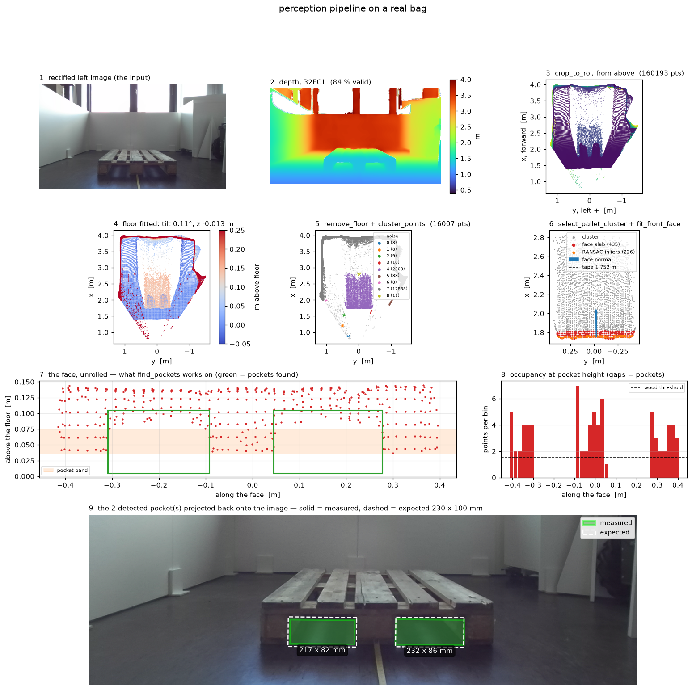
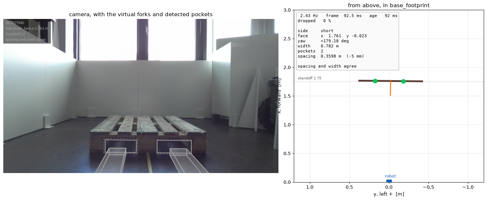
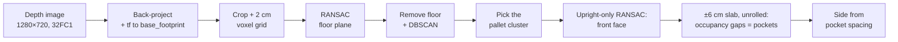
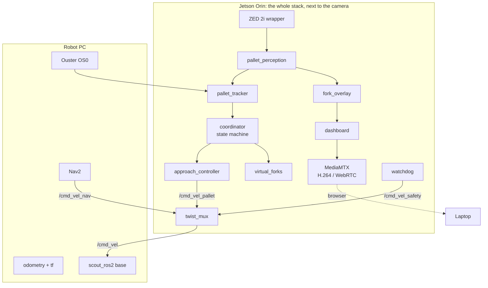
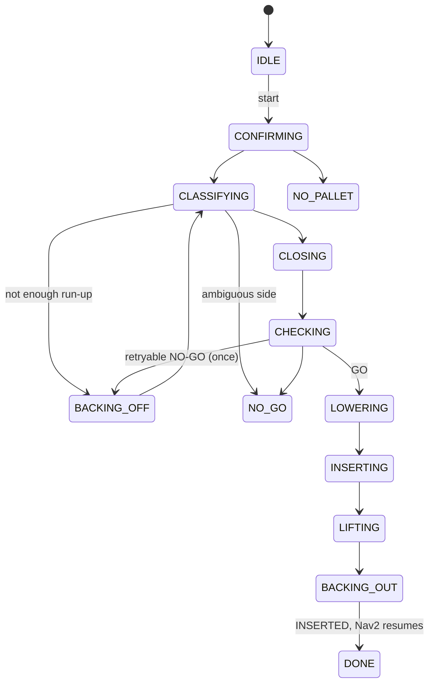
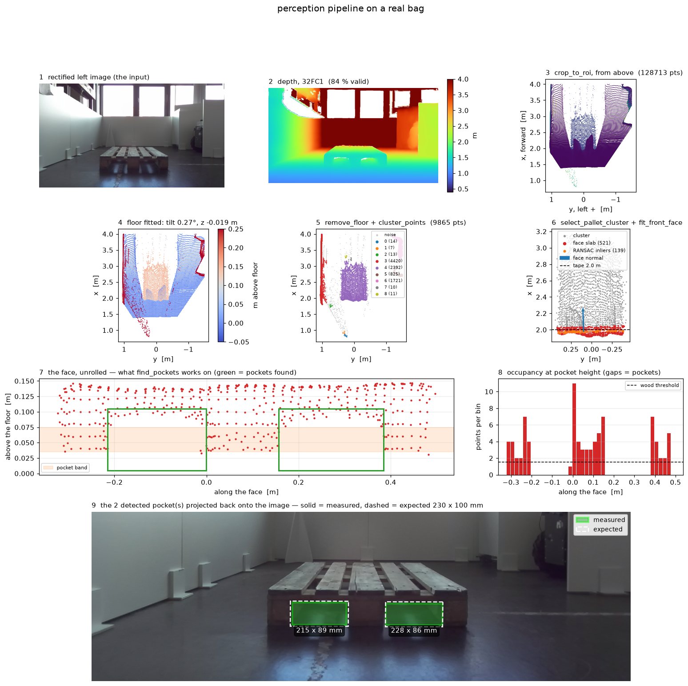
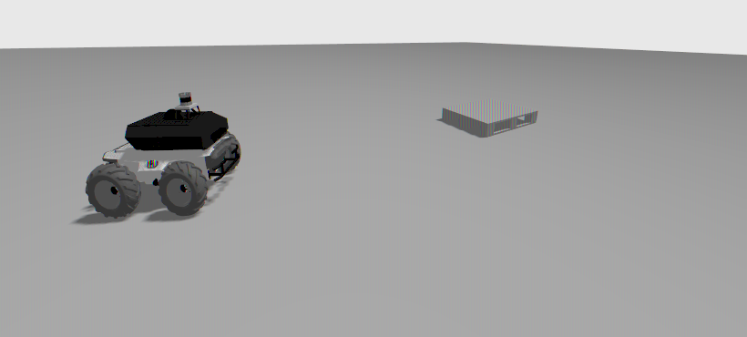
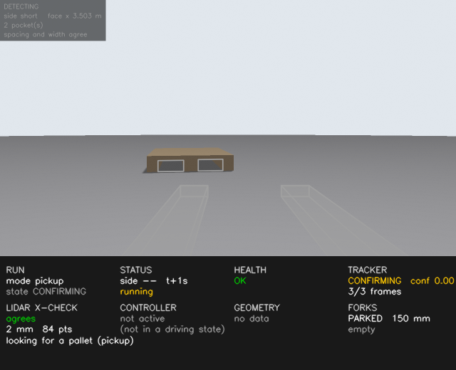

# Pallet Approach on a Real Robot

Stereo-vision pallet detection, fork-pocket alignment and a virtual pickup on an
AgileX SCOUT 2.0 with a ZED 2i camera and an Ouster LiDAR, in ROS 2 Humble.

Nav2 brings the robot to within a few metres of a pallet. This stack is
designed to take over from there. It confirms the pallet in stereo depth,
cross-checked by the LiDAR, and works out which face it is looking at. It then
drives onto the fork-pocket centre line and decides **GO** or **NO-GO** with a
stated reason. On GO it performs a **virtual pickup**: it lowers imaginary forks
to pocket height, drives them in, lifts, backs out, and hands control back to
Nav2.

> **Status.** Perception has been validated on depth recorded on the robot. The
> complete pipeline runs end to end in Gazebo against a model of the lab robot,
> and in an offline replay that drives the real state machine, control laws and
> safety rules against a simulated world. The approach controller is still being
> tuned, and nothing has run closed-loop on the robot yet.

There is no trained model. The pipeline is plane fitting, clustering and gap
analysis, so it needs no labelled data and every decision it makes can be read
off a log.

<!--
  Robot photo: save it as docs/images/robot.jpg and uncomment this line.
  <p align="center"></p>
-->

<p align="center">
  
  <br>
  <em>Every stage of the perception pipeline on a real recorded frame, short
  face 1.75 m ahead. Both pockets found (solid green: 217 × 82 and
  232 × 86 mm) where the measured 230 × 100 mm pockets should be (dashed).</em>
</p>

<p align="center">
  
  <br>
  <em>The pipeline running on a recorded bag from the robot, as the operator sees
  it: the virtual tines drawn from the robot's own geometry, the detected
  pockets (solid) on their expected outlines (dashed), and the same estimate
  from above. Short face at 1.76 m, spacing within 5 mm.</em>
</p>

## Contents

- [What it does](#what-it-does)
- [How it works](#how-it-works)
- [Architecture](#architecture)
- [Safety design](#safety-design)
- [Results so far](#results-so-far)
- [Simulation](#simulation)
- [Getting started](#getting-started)
- [Repository layout](#repository-layout)
- [Documentation](#documentation)

## What it does

| Phase | What happens |
|---|---|
| Confirm | Several consistent depth frames, tracked in `odom`, with the LiDAR seeing a surface where the camera put the face |
| Classify | Short face or long face, from the pocket spacing (365 vs 525 mm), confirmed by the face width; ambiguous is refused, never guessed |
| Approach | Reverse for run-up if needed, then a continuous servo onto the pocket centre line, squaring up at a 1.75 m standoff |
| Check | Eight safety rules on a stationary robot: GO or NO-GO, always with a reason |
| Pick up | Forks down to the opening's centre, straight in with a LiDAR distance stop, lift, back out, hand back to Nav2 |

One run mode, `pickup`: the whole sequence. (An approach-only mode was removed
in D95; a dry run uses the wheels-disconnected launch instead.)

The real pallet was tape-measured, and the measurements replace the EPAL
nominals everywhere: 1195 × 795 × 145 mm, with two 230 × 100 mm pockets on the
short face, centres 365 mm apart, **open from the floor**. That last detail
changed the fork height, the standoff and the pocket detection band.

## How it works

### Perception: depth image to pockets



Three design choices carry most of the weight:

- **Heights come from the fitted floor, never from `z = 0`.** The URDF's
  `base_footprint` turned out to be 25 mm above the real floor, and the pockets
  are only 100 mm tall.
- **The face fit only proposes upright planes facing the robot.** The camera
  sits 0.40 m up and looks down, so a general RANSAC picks the top deck. Two
  points define a vertical plane, which also makes the search cheap.
- **Pockets are found in a ±6 cm slab around the face, not in the plane's
  inliers.** At 2 m the ZED's depth scatters by a few centimetres, so 2 cm
  inliers miss the block fronts. The pockets stay empty in the slab because
  they are deep.

### Tracking and the closing servo

The tracker holds the pallet in `odom` with the robot's own motion taken out,
and deliberately does not average: averaging would lag the truth by about
0.10 m at the closing speed. The approach is a cascade of two proportional
loops. The outer loop turns the lateral offset into an aim angle (capped at
0.25 rad so the pallet never leaves the camera's view), and the inner loop turns
the heading error into an angular rate. Commands below the base's minimum turn
rate are dropped rather than inflated, which is what gave the loop fine
authority.

### GO / NO-GO

Face fit quality, estimate stability, pocket count, pocket size for this face,
yaw, lateral offset, overhanging load and obstructions in the pockets. Every
rule runs and is recorded even after one fails, so each decision shows which
rule would have caught what. Missing data is a NO-GO. NO-GOs about where the
robot stands (yaw, offset, stability) are retried once; NO-GOs about the pallet
are not.

### The blind insertion

The camera loses the pockets' top edge once the face is closer than 1.17 m to
the robot centre (computed from the measured camera pose), 0.58 m into the
1.05 m insertion. Insertion therefore runs straight on odometry with angular
velocity exactly zero, at the slowest speed, and the LiDAR keeps the face in
view all the way to the stop. It stops on the earlier of the planned travel and the LiDAR
seeing the face at 0.70 m, which leaves 0.91 m of fork depth and a 0.24 m gap
between the real bumper and the pallet. Half a second without a LiDAR reading
aborts it.

## Architecture



Everything runs on the Jetson, so depth never crosses the network: only
velocity commands, odometry, tf and the LiDAR do. That rule is the result of a
measurement: one remote subscriber to raw ZED images dropped the camera node
from about 37 Hz to 0.2 Hz. Viewing therefore goes through a dashboard
composited on the Jetson and streamed as H.264 over WebRTC.

None of the algorithm modules in `pallet_approach/pallet_approach/*.py` import
ROS. The node wrappers in `nodes/` subscribe, publish and call into them. That
split is what lets a whole virtual pickup run at a desk against a simulated
world, which is where most of this project's bugs were found.

### The state machine



From any running state, a cancel, an unhealthy stack, a lost pallet or a
controller abort stops the robot and ends in **ABORTED**. The controller may
only be told to drive in four states: `BACKING_OFF`, `CLOSING`, `INSERTING` and
`BACKING_OUT`.

## Safety design

- **Every terminal state stops the robot with an explicit zero command.** The
  base driver has no command timeout, so nothing else would. That includes an
  aborted insertion, which stops where it is rather than reversing blind.
- **The watchdog owns the stop independently of the coordinator.** It watches
  sensor ages and rates itself and feeds `twist_mux`'s highest-priority input,
  so a wedged coordinator still leaves a stationary robot.
- **Only four states may drive**, and the test suite asserts that over every
  event from every state. A state added later without thinking about it cannot
  drive.
- **The controller cannot publish until the coordinator activates it**, and it
  refuses to configure if nothing subscribes to its command topic, so a missing
  mux cannot fail silently.
- **Speed limits live in `config/params.yaml`**: 0.20 m/s and 0.30 rad/s, with
  slower limits near the pallet and 0.05 m/s for insertion. Every command is
  clamped and acceleration-limited.
- A run is refused if the stack is unhealthy when the trigger arrives, naming
  the stale or slow sensor.
- Controller and coordinator changes are replayed offline before they run on
  the robot, and someone supervises every run with the e-stop in reach.

## Results so far

Each number below is labelled by where it comes from. No accuracy or false-GO
figures are claimed until they come from evaluation trials on the robot.

| Result | Source | Value |
|---|---|---|
| Face distance error, short face at 1.75 m | real bag | +5 mm, against the target distance |
| Pocket spacing error, same bag | real bag | −3 mm against the measured 365 mm |
| Face distance, first bag at 2.0 m | real bag | on the 2.0 m tape mark |
| Floor height in the URDF's `base_footprint` | measured | −25 mm |
| Camera mounting error | measured | 0.70° pitch, −0.52° roll; corrected in config |
| Closest face the LiDAR still sees | measured | 0.238 m gap to the bumper |
| Worst arrival of the closing servo | simulated, 10 mm depth noise | 17 mm and 2.4°, against 65 mm of pocket slack |
| Unit and integration tests | synthetic | 850 pass |

The first real bag, taken at 2.0 m, with the three fixes it prompted applied
(a narrower detection band, a slab instead of inliers, two points per bin):

<p align="center">
  
</p>

Status: perception has run on recorded bags from the robot. The complete
pipeline runs end to end in Gazebo and in the offline harness; the approach
controller is still being tuned. Nothing has yet driven on the robot. See
[docs/ROADMAP.md](docs/ROADMAP.md).

## Simulation

The same stack container and launch file run against a Gazebo Fortress model of
the lab robot. The robot is built from its own URDF macros, its sensors publish
on the real topic names and frames, and the pallet is the measured one. The
simulation covers what the offline harness cannot: discovery, QoS, lifecycle,
tf and the clock.

<p align="center">
  
  <br>
  <em>The Gazebo world: the SCOUT and the measured pallet 3.5 m ahead.</em>
</p>

<p align="center">
  
  <br>
  <em>The live dashboard during a simulated run: the virtual tines, both pockets
  detected, the LiDAR agreeing with the camera's face to 2 mm, and the tracker
  confirming.</em>
</p>

<!--
  Demo video or GIF of a run: save it as docs/images/demo.gif and uncomment.
  <p align="center"></p>
-->

```bash
./sim/run_sim.sh build
./sim/run_sim.sh up face_x:=3.5 face_y:=0.25 face_yaw:=0.1
./sim/run_sim.sh run pickup
# dashboard: http://localhost:8889/dashboard
./sim/run_sim.sh stop
```

Run it on a machine with a dedicated GPU. On a laptop iGPU the rendered depth
arrives too slowly, perception falls behind, and the watchdog correctly aborts
the run on a stale estimate. The simulation runs on its own ROS domain,
localhost only, so it cannot reach the real robot. What it does and does not show is in
[sim/README.md](sim/README.md).

## Getting started

### On the robot

Everything runs in one container on the Jetson. `up` starts every node and then
waits; nothing moves until a run is triggered.

```bash
./docker/build_and_run.sh build
./docker/build_and_run.sh dry      # first time: wheels disconnected
./docker/build_and_run.sh up
./docker/build_and_run.sh logs
./docker/build_and_run.sh stop
```

The flow is sequential: Nav2 drives the robot in front of a pallet and
finishes, then the pipeline is triggered.

```bash
./docker/build_and_run.sh start pickup
./docker/build_and_run.sh cancel
./docker/build_and_run.sh status
```

These run `pallet_approach/tools/trigger.py` inside the stack's container. It
waits until the coordinator's subscription is matched before sending, then
reports the coordinator's reaction ("coordinator: CONFIRMING ..."). If nothing
subscribes, it says so, which means that shell cannot reach the stack over DDS.

Avoid `ros2 topic pub --once` from another machine. In Humble it sends its one
message without waiting for the subscriber to be matched, and the start topic
is deliberately not latched, so the message often reaches nobody and the stack
logs nothing at all. If you do publish by hand, run `ros2 topic info -v
/pallet_approach/start` from the same shell first: it should list the
coordinator as a subscriber. The result of a run is on `/pallet_approach/result`.

Or as an action, with live feedback (Ctrl-C cancels and the robot stops):

```bash
ros2 action send_goal /pallet_task pallet_approach_interfaces/action/PalletTask \
    "{mode: pickup}" --feedback
```

Watch from any browser on the robot's network, no ROS install needed:

```text
http://<jetson-ip>:8889/dashboard    forks, pockets, health, tracker, controller, reason
http://<jetson-ip>:8889/zed          the raw camera
```

### A whole pickup at a desk

```bash
cd pallet_approach
python3 tools/sequence.py                   # a clean run from 3.5 m
python3 tools/sequence.py --range 2.5       # too close: it reverses first
python3 tools/sequence.py --noise 0.005 --seeds 10
python3 tools/sequence.py --break-gain      # a sign error in the servo
```

This drives the real state machine, tracker, control laws, fork simulator and
safety rules through a simulated world, and prints a phase-by-phase trace.

### Tests

```bash
cd pallet_approach
python -m pytest test
```

If ROS from another distribution is on your `PYTHONPATH`, run the tests from a
virtualenv with `env -u PYTHONPATH PYTEST_DISABLE_PLUGIN_AUTOLOAD=1`.

### Recorded bags

Bags are read offline with the `rosbags` library; no ROS needed.

```bash
./pallet_approach/tools/fetch_bag.sh -o pallet_2m_0deg -d 20        # record on the Jetson, copy here
python3 pallet_approach/tools/bag_to_frames.py ~/bags/pallet_2m_0deg --out /tmp/frames
python3 pallet_approach/tools/replay.py ~/bags/pallet_2m_0deg --truth-x 2.0
```

`replay.py` runs the whole perception pipeline on a bag and draws every stage,
as in the figures above. Ground truth for each bag lives in
[docs/dataset.md](docs/dataset.md).

## Repository layout

```text
pallet_approach_interfaces/      action + messages (ament_cmake)
pallet_approach/
  pallet_approach/               algorithms, no ROS imports
    perception.py                depth -> face pose, pockets, which side
    tracker.py                   the same pallet over several frames, + LiDAR check
    go_nogo.py                   the safety rules
    closing.py                   the servo onto the pocket centre line
    insertion.py                 the blind drive and its two-source stop
    drive.py                     executing one drive request
    forks.py                     the virtual carriage
    coordinator.py               the state machine for a whole pickup
    health.py                    is the stack fit to drive?
    fork_overlay.py, dashboard.py   what the operator sees
    approach.py, controller.py   standoff geometry; limits, deadband, acceleration
    model.py, pointcloud.py, ros_conversions.py, projection.py, calibration.py
    nodes/                       ROS 2 wrappers (lifecycle where it matters)
  config/params.yaml             every tunable value, with its derivation
  config/twist_mux.yaml          velocity arbitration
  launch/                        one entry point + the video streams
  test/                          pytest: synthetic clouds, a simulated world, a whole run
  tools/                         bag recording, offline replay, survey, a whole pickup
sim/                             Gazebo Fortress model of the robot and pallet
docker/                          the Jetson image and its run script
docs/                            design record, system facts, roadmap, dataset, log
```

## Documentation

| Document | What is in it |
|---|---|
| [docs/decisions.md](docs/decisions.md) | Every behaviour decision (D1–D58): what, why, when |
| [docs/SYSTEM.md](docs/SYSTEM.md) | Measured facts about the robot: topics, frames, calibration, network |
| [docs/ROADMAP.md](docs/ROADMAP.md) | Build order, stages, lab sessions, what is still open |
| [docs/dataset.md](docs/dataset.md) | The recorded bags and their ground truth |
| [docs/log.md](docs/log.md) | Daily engineering log: what broke and how it was fixed |
| [sim/README.md](sim/README.md) | The Gazebo simulation, and its limits |

## Hardware and software

- AgileX SCOUT 2.0 skid-steer base, wheel odometry
- Stereolabs ZED 2i on an NVIDIA Jetson Orin (JetPack 6.2, ZED SDK 5.4)
- Ouster OS0 LiDAR
- ROS 2 Humble, Ubuntu 22.04, Python 3.10, Docker; NumPy and scikit-learn for
  the geometry, GStreamer and MediaMTX for video

## License

[MIT](LICENSE)
