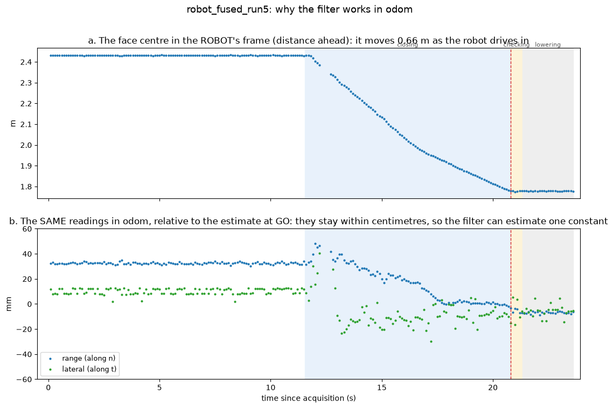
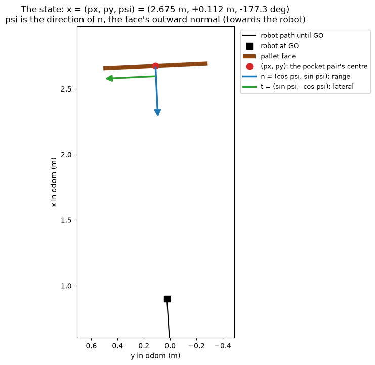
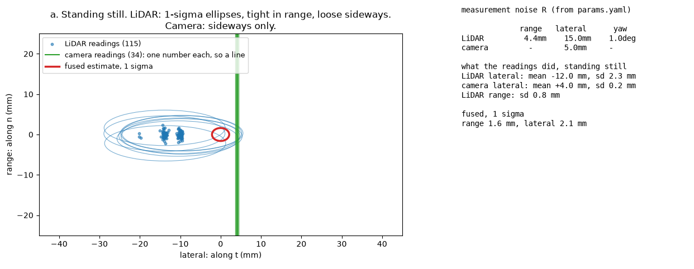
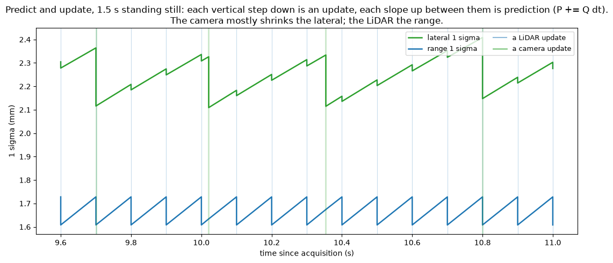
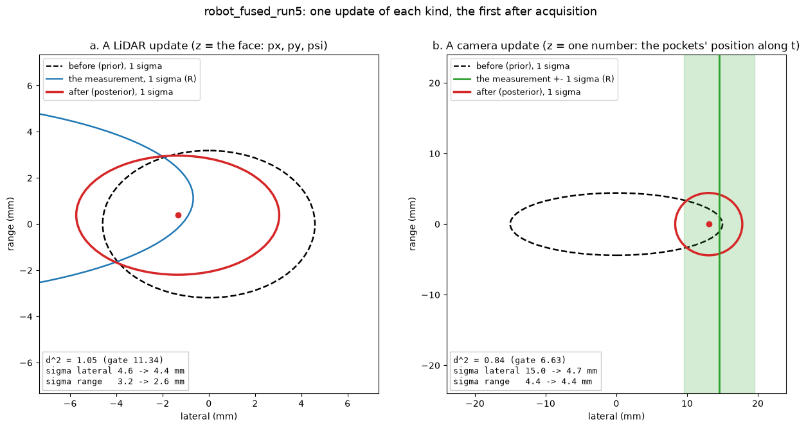
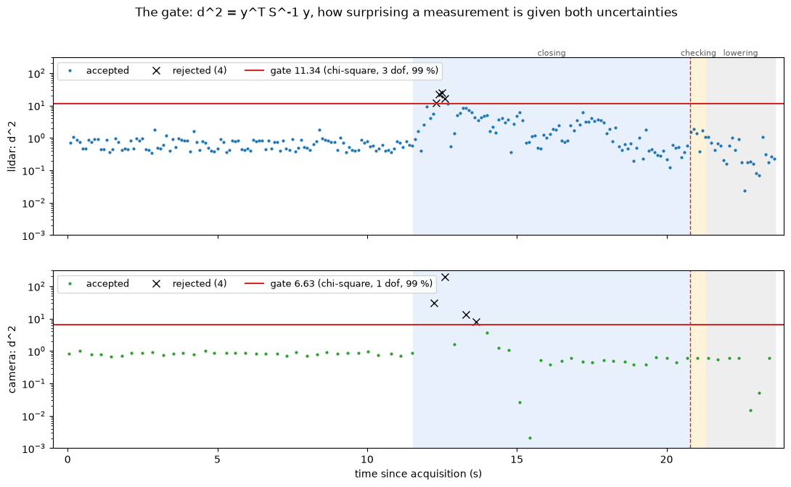
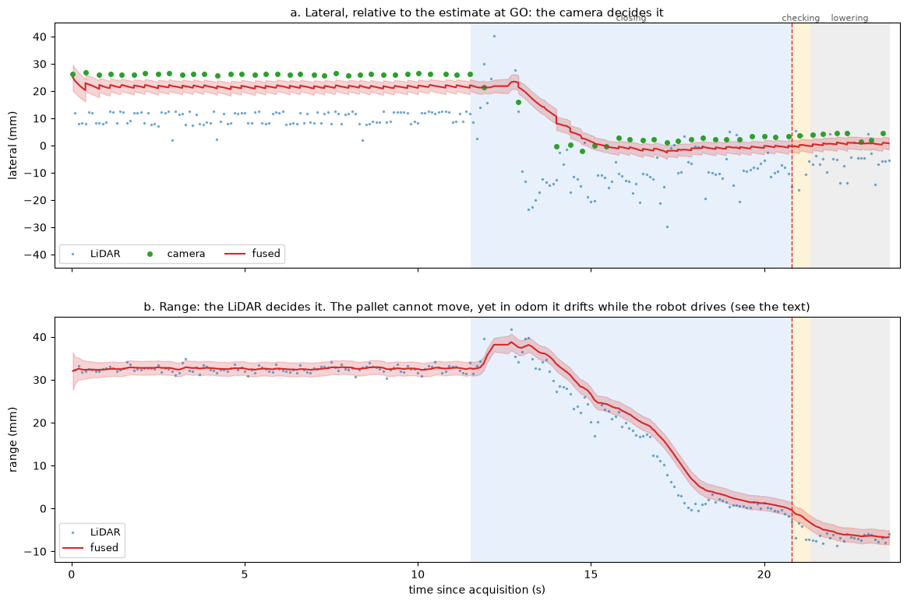
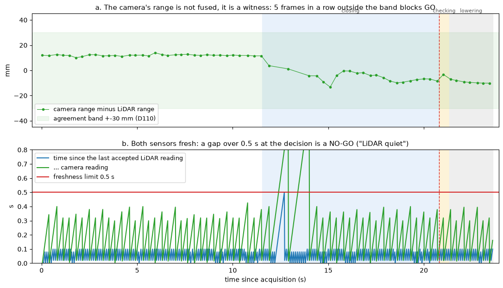

# How the camera–LiDAR Kalman filter works

The fused perception (D102) combines two sensors into one estimate of where the
pallet is: the Ouster LiDAR and the ZED stereo camera. This document explains
that filter step by step. It gives each step's maths and the lines of code that
do it, and pairs it with a figure from **one real recorded pickup**
(`robot_fused_run5`, 29 Oct 2026). That run's short face was 2.43 m away,
17 mm off-centre, and it ended INSERTED.

The figures were made by replaying that bag through the real code, fed the way
the robot's fusion node feeds it:

```bash
python3 pallet_approach/tools/kalman_figures.py ~/bags/robot_fused_run5 --outdir docs/images/kalman
```

The replay reproduces the robot. At the GO decision, its estimate matches what
the robot computed live to within **1.0 mm in range, 1.4 mm sideways and 0.01°**.
Every number below is from that replay. The code is `pallet_approach/fusion.py`
(`PalletFilter`), fed by `fused_pipeline.py` (`FusedPipeline`).

One caveat about the data: the bag's depth was recorded at 3 Hz, while the robot
processed it at 15 Hz. So the replay has fewer camera updates than the live run.
The LiDAR is complete, at 10 Hz.

---

## 1. Why the filter works in odom

The robot drives towards the pallet. In the robot's own frame (`base_footprint`)
the pallet moves: its face comes 0.66 m closer during this run (figure a). In
`odom`, the frame odometry measures the robot's motion in, the pallet stands
still. Each reading is moved into `odom` with the robot's pose at the moment of
the reading, and then the same readings stay within a few centimetres
(figure b).

So the filter has **one constant** to estimate: where the pallet is. Every
reading from either sensor is evidence about that same unknown.



The transform, for a point p measured in the robot's frame when the robot's
odom pose is (r, θ_r):

```
p_odom = r + Rot(θ_r) p_base,      Rot(θ) = [cos θ  −sin θ; sin θ  cos θ]
ψ_odom = ψ_base + θ_r
```

That is `fusion.to_odom`. The pose has to be the one at the moment the reading
**describes**, which is not always the moment on its stamp:

- **LiDAR:** a sweep's stamp is its start. The points straight ahead, where the
  pallet is, are measured about 51 ms later (`fused_pipeline.forward_time`).
- **Camera:** with depth stabilization on, the depth describes the scene about
  170 ms before its stamp (D107).
- **Odometry:** interpolated between samples to that exact time
  (`fused_pipeline.pose_at`).

Figure b is not perfectly flat. Once the robot moves, the readings drift by
about 4 cm in range. Section 7 discusses this.

## 2. The state, and the face's own axes

The filter estimates three numbers, and how uncertain it is about them:

```
x = [px, py, ψ]ᵀ         in odom
P = 3×3 covariance
```

- (px, py) is the **centre of the pocket pair**, on the block-front line.
- ψ is the direction of the face's **outward normal**, pointing at the robot.

Two unit vectors fixed to the face are used everywhere below:

```
n = [cos ψ,  sin ψ]       the normal: "range", towards the robot
t = [sin ψ, −cos ψ]       the tangent: "lateral", along the face
```



At the GO decision of this run: x = (2.675 m, +0.112 m, −177.3°).

## 3. What each sensor measures, and how well

The two sensors are good at **different directions**. That's the whole reason
to fuse them.

| Sensor | Measures | σ along n (range) | σ along t (lateral) | σ yaw |
|---|---|---|---|---|
| LiDAR | the face: position and angle | 4.4 mm at this distance (range study, D109) | 15 mm (its columns are ~15 mm apart at 2.5 m) | 1° |
| Camera | only the pockets' position *along the face* | — | 5 mm | — |

A sensor's error is simple in the face's axes, so its covariance is built there
and rotated into `odom`:

```
R_xy = σ_range² · n nᵀ + σ_lat² · t tᵀ          (= Rot · diag(σ_range², σ_lat²) · Rotᵀ)
```

In code (`PalletFilter._lidar_r`):

```python
r[:2, :2] = self.lidar_sigma_range(distance) ** 2 * np.outer(n, n) \
          + p['lidar_sigma_lateral'] ** 2 * np.outer(t, t)
r[2, 2]   = math.radians(p['lidar_sigma_yaw_deg']) ** 2
```



In the 11.5 s before the robot moved:

- **LiDAR:** 115 readings, sideways mean −12.0 mm (sd 2.3 mm), range sd 0.8 mm.
- **Camera:** 34 readings, sideways mean +4.0 mm (sd 0.25 mm).
- **Fused:** 1σ of 1.6 mm in range and 2.1 mm sideways, sitting near the camera,
  which carries 9 times the weight sideways (5 mm against 15 mm).

Notice the gap: each sensor repeats itself to within a few millimetres, yet the
two disagree sideways by 16 mm. That is a constant **offset** between the
sensors, not noise. It's why R is set to each sensor's absolute accuracy against
the tape, not its frame-to-frame scatter. Section 9 returns to this.

## 4. Predict: the uncertainty grows with time

The pallet doesn't move, so prediction leaves the estimate where it is and only
lets the uncertainty grow:

```
x⁻ = x
P⁻ = P + Q·Δt,     Q = diag(σ_xy², σ_xy², σ_ψ²),   σ_xy = 2 mm/√s,  σ_ψ = 0.2°/√s
```

Q is not "the pallet might move". It's the **odometry's drift**. Readings are
moved into `odom` with the odometry pose, so a drifting odometry makes the
pallet *appear* to drift. The growth is a random walk: uncertainty grows with
√time.

```python
# PalletFilter.predict
dt = max(0.0, stamp - self.stamp)
self.P = self.P + q * dt
```

Because of the `max`, the filter never runs backwards in time. A camera frame
stamped 170 ms in the past can arrive after a newer LiDAR sweep. It then gets
Δt = 0, which is harmless because the state doesn't change in prediction.



The figure shows the rhythm. Each slope up is a prediction; each vertical step
down is an update:

- **The LiDAR (10 Hz) resets the range** to about 1.6 mm every 0.1 s.
- **The camera (here about every 0.33 s) resets the sideways position** from
  about 2.35 to 2.1 mm.
- Neither sensor does much for the other's direction.

## 5. Update: combining one measurement

An update weighs the estimate against a new measurement z, using their
uncertainties. The general form, used by both sensors (`PalletFilter._update`):

```
y = z − H x⁻                  innovation: what the sensor saw, minus what was expected
S = H P⁻ Hᵀ + R               how uncertain that difference is
d² = yᵀ S⁻¹ y                 how surprising it is (section 6)
K = P⁻ Hᵀ S⁻¹                 the gain: how much to believe the measurement
x = x⁻ + K y
P = (I − K H) P⁻,  then symmetrised
```

```python
innovation = z - h @ self.x
innovation[angle_row] = wrap(innovation[angle_row])      # angles wrap at ±180°
s  = h @ self.P @ h.T + r
d2 = float(innovation @ np.linalg.solve(s, innovation))
if d2 > gate: self.rejected += 1; return False
k = self.P @ h.T @ np.linalg.inv(s)
self.x = self.x + k @ innovation
self.P = (np.eye(3) - k @ h) @ self.P
```

In one dimension the gain is easy to read: K = σ_before² / (σ_before² + σ_meas²).
A measurement much better than the estimate gets K ≈ 1; a much worse one gets
K ≈ 0.

**The LiDAR measures all three numbers:** z = [c_x, c_y, ψ_face] (in odom),
H = I₃, R as in section 3 (`update_lidar`).

**The camera measures one number**, the pockets' position along the face:

```
z = tᵀ c_cam,      H = [t_x, t_y, 0],      R = (5 mm)²
```

```python
# PalletFilter.update_camera
t = np.array([math.sin(self.x[2]), -math.cos(self.x[2])])
h = np.array([[t[0], t[1], 0.0]])
ok = self._update(np.array([t @ pocket_centre]), h, np.array([[camera_sigma_lateral ** 2]]), gate_chi2_1d)
```

Two details here:

- **t comes from the current angle estimate.** Strictly, the measurement is
  nonlinear in ψ. Fixing t at the current estimate is a first-order
  linearisation, as in an extended Kalman filter. At these angle uncertainties
  the error is negligible.
- **The third entry of H is 0.** A camera reading can't change the angle
  directly.



The two updates in the figure, the first of each kind after acquisition:

| | Camera, at 0.04 s | LiDAR, at 0.20 s |
|---|---|---|
| Innovation | 14.5 mm sideways | −15.7 mm sideways, small in range and angle |
| d² against the gate | 0.84 < 6.63 | 1.05 < 11.34 |
| Gain, sideways | **0.90** = 15² / (15² + 5²) | **0.086** = 4.6² / (4.6² + 15²) |
| Gain, range | 0 (H has no n part) | **0.34** = 3.2² / (3.2² + 4.4²) |
| σ sideways | 15.0 → **4.7 mm** | 4.6 → 4.4 mm |
| σ range | 4.4 → 4.4 mm (unchanged) | 3.2 → **2.6 mm** |

These two rows are the whole idea of the fusion. The camera's single reading
cuts the sideways uncertainty by two thirds and leaves the range alone. The
LiDAR barely moves the sideways estimate, because by then it was already better
than the LiDAR's own 15 mm, but it tightens the range. Every gain can be checked
with the 1-D formula.

## 6. The gate: refusing a surprising measurement

Before a measurement is used, its d² is compared with a threshold. d² is a
squared distance measured in units of the combined uncertainty S. It's
"how many sigma off", generalised to several dimensions.

| Sensor | Dimensions | Gate | Meaning |
|---|---|---|---|
| LiDAR | 3 | 11.34 | 99 % of correct readings fall below it (χ², 3 dof) |
| Camera | 1 | 6.63 | 99 % (χ², 1 dof) |



Standing still, every reading stays far below its gate. All 8 rejections in this
run (4 per sensor) come in the first 2 s after the robot starts moving: the
readings shift at once (section 7) while the estimate is still where it was.
That's a cost of gating: it protects against one bad reading, but it also
briefly refuses a **real** change until the estimate catches up.

## 7. Over the whole approach



- **Sideways (a):** the camera decides it. The fused line stays close to the
  camera's points, and the LiDAR's spread hardly moves it.
- **Range (b):** the LiDAR decides it. The camera doesn't take part.

Something the filter can't explain is visible here. The pallet doesn't move, yet
in `odom` its range estimate drifts **39 mm**, and the sideways one steps
**21 mm**, while the robot drives 0.66 m. Possible causes:

- **Odometry error:** skid-steer wheels slip. If this were the only cause, both
  sensors would shift together.
- **A range error that changes with distance:** in the camera, the LiDAR, or
  their calibration.

Figure 8a shows that camera-minus-LiDAR also changes by about 20 mm over the
same stretch, so it isn't odometry alone. Which part is which is still open
(docs/TODO.md). The filter handles the drift because Q lets the estimate move:
it **follows** it rather than detecting it.

## 8. What GO needs besides the estimate

The estimate alone isn't enough for GO (D104). Three more checks have to pass:

1. **The camera's range is a witness, not a measurement.** It doesn't enter the
   filter. Each frame, the camera's distance to the face is compared with the
   LiDAR's (`check_camera`). If they differ by more than 30 mm (D110), or by
   more than 3° in angle, for 5 frames in a row, GO is blocked.
2. **Both sensors fresh:** an accepted reading from each within the last 0.5 s
   (`lidar_max_age`, `camera_max_age`).
3. **Both sensors steady:** both accepted for the last 5 frames, with nothing
   gated out (`healthy_frames`).



In this run:
- the witness stayed within ±15 mm;
- the LiDAR's longest gap was 0.50 s, exactly at the limit, during the
  rejections at the start of closing;
- the camera's longest gap was 1.1 s, at the same moment.

Both were fresh again long before the decision. At GO (20.8 s) the filter's 1σ
was 1.7 mm in range, 2.1 mm sideways and 0.25° in angle. In the simulator's
proud-block runs, the same 0.5 s freshness rule is what fails at the moment of
the decision ("LiDAR quiet").

## 9. Limitations

- **The camera's error isn't independent from frame to frame.** A Kalman filter
  assumes each measurement's error is fresh noise. The camera's isn't: its error
  holds steady while the view does (section 3: sd 0.25 mm between frames, but
  16 mm away from the LiDAR). Ten frames of one view count as ten independent
  opinions, so the filter's claimed 2 mm sideways is **too confident**. On the
  two bags with a taped sideways offset, the real error was −12 mm and −3 mm.
  The fix would be to model the camera's offset as its own slowly changing
  state, or to keep the camera's effective σ from shrinking below its per-view
  scatter. That's an open decision.
- **The range drift in section 7 is unexplained.** The filter follows it; it
  can't tell which sensor or the odometry is wrong.
- **The noise values are partly provisional.** The LiDAR's range σ comes from a
  range study that didn't converge (D109). The 15 mm, 5 mm and 1° are reasoned
  from resolution and the tape bags, not fitted.
- **The camera update is linearised around the current angle.** This is
  negligible here, but it would matter with a poor first angle.

## Parameters

All in `config/params.yaml`, block `fusion`, except where noted:

| Parameter | Value | Role |
|---|---|---|
| `lidar_sigma_lateral` | 0.015 m | R, LiDAR along t |
| `lidar_sigma_range` | 0.004 m | R, LiDAR along n; replaced by `range_error.lidar` when the distance is known (D109) |
| `lidar_sigma_yaw_deg` | 1.0° | R, LiDAR angle |
| `camera_sigma_lateral` | 0.005 m | R, camera along t |
| `process_sigma_xy` | 0.002 m/√s | Q, position |
| `process_sigma_yaw_deg` | 0.2°/√s | Q, angle |
| `gate_chi2_3d` / `gate_chi2_1d` | 11.34 / 6.63 | gates (99 %) |
| `disagree_range` / `disagree_yaw_deg` / `disagree_frames` | 0.030 m / 3° / 5 | witness check (D110) |
| `lidar_max_age` / `camera_max_age` | 0.5 s | freshness |
| `healthy_frames` | 5 | steadiness |
| `fused_pipeline.camera_max_range` | 2.5 m | the camera is ignored farther than this (D108) |
| `camera_depth.latency` | 0.17 s | the camera's time correction (D107) |
